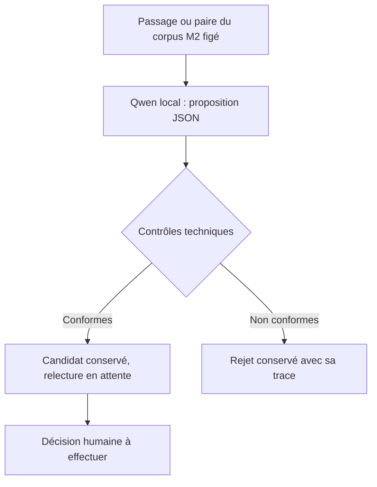

# Agent0 Light : bilan pour la remise et l'oral

**État vérifié :** 23 novembre 2026, `dev/85e9710afd974fa1c722f7491ff55ed080200b09`. **Responsable :** Jibril BENSALEM, avec l'assistance de Codex dans ChatGPT Work. **Relecture de cette actualisation :** Mahé BEGNIS ou Remy RAYANE ; une validation explicite de l'un des deux, distinct de l'auteur, suffit. Les approbations des versions antérieures ne sont pas attribuées à ce nouveau texte.

## 1. Décision pour la remise

Jibril confirme le 23 novembre de **figer le développement Agent0 pour la remise** et de valoriser les réalisations, les essais et leurs limites. Aucune nouvelle génération, constitution de pilote, évaluation synthétique ou boucle ciblée n'est engagée avant cette remise. La suite reste une ouverture, soumise à une nouvelle décision de reprise.

Les tickets #91 à #95 sont clos sur le périmètre livré. #96 à #98 restent ouverts comme suites reportées ; leur état ouvert ne constitue pas un engagement de livraison. Les anciennes dates de novembre sont historiques. Ce gel du développement ne signifie pas qu'un jeu de questions serait relu ou figé.

**Message central :** le générateur fonctionne et ses contrôles sont traçables ; la qualité générale des questions et un gain du RAG ne sont pas démontrés.

## 2. Fonctionnement à expliquer

Agent0 Light utilise Qwen2.5-7B-Instruct Q4_K_M, servi localement par Ollama, pour proposer une question et des preuves à partir d'un ou deux passages du corpus M2 figé. Les catégories sont simple, reformulation, multi-passage, piège à fausse prémisse et proposition hors corpus.

Le programme contrôle la structure JSON, les champs, les identifiants, les extraits exacts, les doublons normalisés et certaines contraintes de catégorie. Il conserve les sources, paramètres, empreintes et sorties brutes. La décision humaine porte sur le sens, les conditions, les exceptions, la catégorie et la suffisance des preuves. Un extrait présent mot pour mot peut rester insuffisant pour répondre.

**Analogie pour l'oral :** Qwen prépare un exercice à partir d'une page d'un dossier ; le programme vérifie le format et les citations proposées, puis une personne doit encore vérifier si l'exercice a du sens. Le RAG intervient seulement dans la future étape d'évaluation, après relecture et gel du lot.

## 3. Réalisé, préparé et reporté

| Élément | État vérifié et portée |
|---|---|
| Contrat, sélection, générateur et cinq catégories | Livrés, relus et intégrés par #99, #100, #101 et #103 ; tickets #91 à #94 clos le 23/11 |
| Support de relecture historique | Livré par #106 ; #95 clos sur ce périmètre, sans acceptation des candidats |
| Essais réels historiques sur le Legion Windows | 18 runs : 15 candidats ayant franchi leurs contrôles historiques, 3 rejets automatiques |
| Relecture sémantique consignée des essais | 15 décisions vierges ; candidats toujours `pending`, aucun hors corpus confirmé |
| Lanceur exploratoire RAG | Code livré par #144, approuvé et fusionné ; aucun benchmark Agent0 réel déclaré |
| Préparation du futur pilote | #145 : 25 emplacements, 25 fiches et 30 passages, méthode hors corpus et grille ; zéro candidat généré, aucun lot évaluable |
| Contrôles de séparation | Qwen : contrôle rapporté par Mahé en revue de #145. Encodeur : 109 paires originales vérifiées dans #153, sans passage, fiche ni texte source intégral communs avec le pilote sur les critères contrôlés ; #153 approuvée puis fusionnée le 16/11 |
| Évaluation et diagnostic | #96 et #97 non exécutés, hors livraison actuelle |
| Boucle ciblée sur les faiblesses | #98 facultative et non réalisée |

Les contrôles de séparation portent sur les lots et les critères identifiés dans leurs rapports. Ils ne certifient pas l'absence de toute paraphrase ou recopie partielle. Les 25 fiches préparées sont aussi des fiches du test humain : les futurs résultats synthétiques devront rester séparés de la mesure officielle. La préparation ne peut pas être présentée comme un nouveau benchmark humain indépendant.

### Deux nombres de tests, deux étapes

| Résultat rapporté | Périmètre | Preuve |
|---|---|---|
| 149 tests réussis | Générateur et contrôles, socle livré | Revue indépendante finale de #103 et [bilan d'intégration](../journal/2026-11-02_agent0_light_integration.md) |
| 184 tests réussis | Suite incluant ensuite le lanceur de #144, avec 35 tests du lanceur | [Revue de Mahé du 11/11 sur a62c9b2](https://github.com/datatigersNLP/data_tigers_nlp/pull/144#pullrequestreview-5860311839), Mac et versions verrouillées |

Ces effectifs ne s'additionnent pas. Aucun test n'est relancé pour la présente actualisation ; aucun des deux nombres ne mesure la pertinence des questions.

## 4. Deux exemples archivés pour expliquer les essais

### Exemple de fonctionnement technique : simple_001

Question originale, conservée mot pour mot :

> Pendant le congé sans solde, le salaire du salarié est-il maintenu ?

Preuve proposée dans `m2-article374529-0004` :

> Pendant le congé sans solde, la rémunération du salarié n’est pas maintenue.

Le candidat a franchi les contrôles historiques et l'extrait est présent dans la source. Il permet de montrer concrètement le lien question/preuve et la provenance. **Ce succès technique ne remplit aucun verdict humain** : le statut du candidat reste `pending` et l'examen du contexte complet reste à effectuer. La lecture assistée antérieure était favorable, sans validation finale.

Sources : [question et provenance originales](agent0_relecture/questions_et_sources.md#simple_001), [passage complet](agent0_relecture/questions_et_sources.md#m2-article374529-0004), [observation assistée](agent0_relecture/observations_assistees.md#simple_001). Identifiant : `SYN_simple_001_0001` ; SHA-256 du JSONL original : `c3d07fb70b38dd69b15b863e9a7d5a6b6444847f3809296ae80ab60b3648690e`.

### Exemple de limite sémantique : hors_corpus_001

Question originale, conservée mot pour mot :

> Quelles conditions doivent être remplies pour que le salarié puisse utiliser son compte épargne-temps (CET) pendant son congé sans solde ?

Le modèle propose `answerable_proposed: false` et affirme que les conditions manquent. Or le même passage indique qu'un CET doit être mis en place, que le salarié peut utiliser ses droits acquis et que cette possibilité doit être prévue par l'accord instituant le CET.

**Ce qu'il faut expliquer :** un format conforme et une liste de preuves vide ne démontrent pas l'absence d'information. Les conditions déjà présentes doivent être examinées avant de retenir le classement hors corpus. L'observation assistée signale cette contradiction ; elle ne devient pas un verdict humain de rejet ou d'acceptation. Aucun cas hors corpus n'est confirmé dans la grille.

Sources : [question et motif originaux](agent0_relecture/questions_et_sources.md#hors_corpus_001), [source complète](agent0_relecture/questions_et_sources.md#m2-article374529-0004), [observation assistée](agent0_relecture/observations_assistees.md#hors_corpus_001). Les deux exemples décrivent l'instantané du corpus, pas une vérification du droit actuel.

## 5. Texte prêt à reprendre dans le rapport

Agent0 Light a été développé pour proposer localement des questions synthétiques à partir du corpus M2 figé. Le générateur couvre cinq catégories, contrôle la structure des sorties, leurs sources et leurs extraits, et conserve les paramètres, empreintes et rejets. Les 18 essais historiques effectués sur le Legion ont produit 15 candidats et 3 rejets automatiques. Les 15 candidats restent en attente de relecture humaine : ils ont servi à la mise au point sur trois fiches et ne constituent pas un benchmark validé. Les essais montrent notamment qu'une proposition conforme au JSON peut déclarer une information absente alors qu'elle figure dans la source. Le lanceur d'évaluation RAG, la préparation de 25 emplacements sur des fiches distinctes de la mise au point et les contrôles de séparation ont ensuite été livrés, sans générer ni figer ce nouveau pilote. Le développement est arrêté pour la remise afin de consacrer le temps restant à la consolidation et à la présentation. L'ouverture consiste à produire un petit lot, le faire relire, figer les seuls cas acceptés, puis exécuter et analyser le RAG avant d'envisager une génération ciblée sur ses faiblesses. Aucun gain de qualité du RAG n'est attribué à Agent0 dans le bilan réalisé.

**Intégration.** Le rapport est en cours dans #178 et les supports J4 dans #162. Ce texte constitue une proposition à reprendre dans leur synthèse et leur ouverture ; les branches de leurs auteurs ne sont pas modifiées par cette actualisation. Le bilan de la mesure officielle du volet B et les autres jeux synthétiques du projet restent distincts d'Agent0 Light.

## 6. Passage oral court et support visuel

Texte proposé, environ une minute visée, à chronométrer en répétition :

> Nous avons aussi développé Agent0 Light pour préparer des questions complémentaires à partir du corpus. Qwen propose une question et ses preuves ; le programme contrôle le format, les sources et les extraits exacts. Sur 18 essais historiques, nous avons obtenu 15 candidats et 3 rejets automatiques. Mais les 15 candidats attendent encore une relecture humaine. Un exemple montre pourquoi : le modèle affirme que les conditions d'utilisation du compte épargne-temps sont absentes, alors qu'elles figurent dans sa source. Un JSON valide ne garantit donc pas une bonne question. Le générateur, le lanceur et la préparation d'un pilote sont disponibles. Nous avons figé le développement pour la remise. L'ouverture est de faire relire et figer un nouveau lot, puis d'évaluer le RAG. Aucun gain du RAG n'est démontré par ces essais.

**À afficher, si une place est prévue dans le support :**

- Génération locale de cas synthétiques traçables, cinq catégories.
- 18 essais historiques : 15 candidats, 3 rejets automatiques.
- Sens et suffisance des preuves : validation humaine encore nécessaire.
- Ouverture : nouveau lot relu et figé, puis évaluation du RAG.

Pour les questions du jury, utiliser les deux exemples archivés ci-dessus. Aucune génération en direct ni nouvelle expérience n'est nécessaire pour les présenter. Le temps réellement disponible dans la présentation reste à confirmer avec l'équipe ; aucune diapositive supplémentaire n'est imposée à #162.

## 7. Réponses aux questions probables du jury

| Question | Réponse courte |
|---|---|
| Est-ce déjà un agent autonome qui améliore le système ? | Le livrable est un générateur local contrôlé et traçable. La boucle d'évaluation et de génération ciblée reste une ouverture. |
| Pourquoi Qwen ? | Il réutilise le modèle local principal du volet B et le service Ollama déjà opérationnel sur le Legion ; aucun nouveau service de génération n'a été nécessaire. |
| Les tests prouvent-ils la qualité des questions ? | Ils vérifient les comportements techniques couverts. Le sens, la catégorie et la suffisance des preuves demandent une relecture humaine. |
| Pourquoi ne pas transformer les 15 candidats en benchmark ? | Ils ont servi à retoucher les prompts sur trois fiches et leurs décisions humaines sont vierges. Ils restent exclus de l'entraînement et du futur pilote, distinct de la mise au point. |
| Comment vérifier le hors corpus ? | Examiner le corpus figé complet, tracer recherches et contre-preuves et faire statuer un humain. Un faible score ou une recherche vide ne suffit pas. |
| Pourquoi arrêter le développement maintenant ? | Le socle retenu est livré ; l'évaluation supplémentaire est reportée pour préserver le temps de validation, de rapport et de préparation de l'oral. |
| Avez-vous amélioré le RAG avec Agent0 ? | Aucun gain n'a été mesuré dans ce chantier. L'adaptation et la mesure officielle du volet B ont leurs propres données et protocoles. |
| Qu'est-ce qui manque pour aller plus loin ? | Une reprise explicite, une configuration arrêtée, la génération du nouveau lot, sa relecture, son gel, puis l'exécution et l'analyse du RAG. |
| Une seule personne peut-elle valider ? | Mahé ou Remy peut valider le livrable final s'il est distinct de son auteur ; une seule validation suffit. Cela ne remplit pas automatiquement la grille des candidats. |

## 8. Sources et limites de ce bilan

- [Étude historique Agent0](agent0_light.md), [originaux vérifiés](agent0_relecture/verification_archive.md), [questions et sources](agent0_relecture/questions_et_sources.md), [grille historique](agent0_relecture/grille_relecture.json).
- [Préparation du pilote](agent0_pilote_independant/README.md), [plan](agent0_pilote_independant/preparation.json), [grille vierge](agent0_pilote_independant/grille_relecture.json) et [contrôle encodeur](agent0_pilote_independant/verification_encodeur_20261112.md).
- PR intégrées : [#99](https://github.com/datatigersNLP/data_tigers_nlp/pull/99), [#100](https://github.com/datatigersNLP/data_tigers_nlp/pull/100), [#101](https://github.com/datatigersNLP/data_tigers_nlp/pull/101), [#103](https://github.com/datatigersNLP/data_tigers_nlp/pull/103), [#106](https://github.com/datatigersNLP/data_tigers_nlp/pull/106), [#144](https://github.com/datatigersNLP/data_tigers_nlp/pull/144), [#145](https://github.com/datatigersNLP/data_tigers_nlp/pull/145) et [#153](https://github.com/datatigersNLP/data_tigers_nlp/pull/153). La revue finale de #153 porte sur `ed1c74d`, approuvé par Mahé le 13/11 et fusionné le 16/11.
- Suites reportées : [#96](https://github.com/datatigersNLP/data_tigers_nlp/issues/96), [#97](https://github.com/datatigersNLP/data_tigers_nlp/issues/97), [#98](https://github.com/datatigersNLP/data_tigers_nlp/issues/98). Les charges des livrables clos ont été déclarées comme estimations rétrospectives non chronométrées ; leur consolidation reste dans #169.

Les deux grilles et les sources historiques sont préservées. Les champs encore en attente dans les documents de préparation ne deviennent pas une preuve de réalisation. Aucun taux de qualité, nouveau résultat, relecture sémantique, entraînement ou temps réel n'est inventé. La [note IA du 23 novembre](../journal/2026-11-23_agent0_gel_bilan.md) consigne cette actualisation documentaire.
