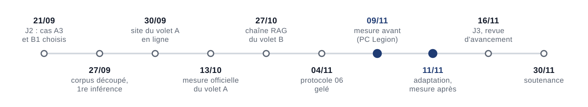
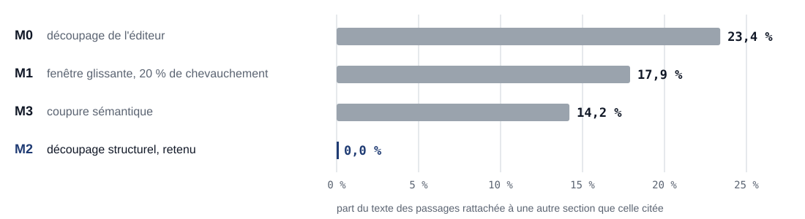
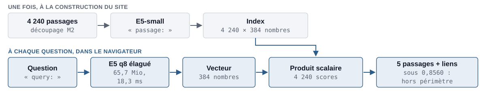
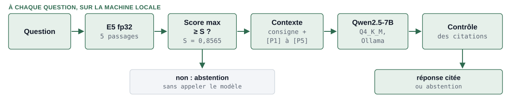
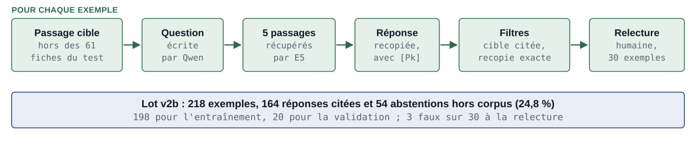
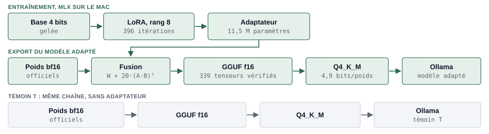
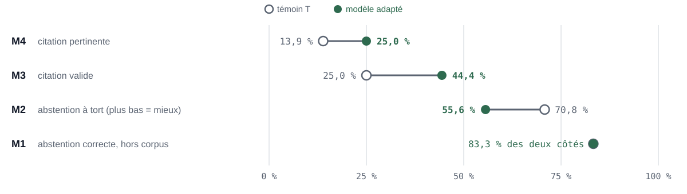
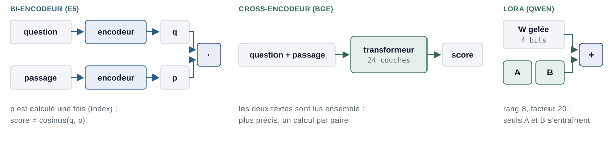

<!-- _class: titre -->

# Démonstration

1. **Volet A, en ligne** : datatigersnlp.github.io/data_tigers_nlp
   - « Est-ce légal de travailler 10 heures dans la même journée ? »
   - « Un fonctionnaire peut-il refuser une mutation dans une autre ville ? »
2. **Volet B, sur le Mac, modèle adapté**
   - « Quelle est la durée maximale de la période d'essai d'un cadre en CDI ? »
   - « Comment est calculée la pension de retraite d'un fonctionnaire ? »
3. **La même question au témoin T, puis au modèle adapté** (question retenue à l'essai)

<!--
Durée visée : 3 min 50 (volet A 1 min 10, volet B 2 min 40). Vidéo de secours du volet B (#111), à lancer si le direct échoue.
Volet A : taper la question des 10 heures ; montrer les 5 passages, la section, le score et le lien profond vers la fiche. Puis la question sur la mutation d'un fonctionnaire : la fonction publique n'est pas couverte par les fiches ; son score maximal (0,832 en fp32) est sous le seuil 0,8560, le site doit le signaler comme hors périmètre. Vérifier ce comportement en répétition : le site encode en q8, la mesure en fp32.
Volet B : scénario de la #158 (Vaneck), resserré pour tenir dans le temps imparti. Les questions ont été écrites pour la démonstration, hors du jeu de test ; leurs réponses sont à confirmer lors de l'essai sur le Mac. La démonstration n'applique pas le seuil S : c'est le modèle qui décide de s'abstenir. Période d'essai : le passage P1 de la fiche « La période d'essai » donne quatre mois pour les cadres ; cliquer sur [P1] pour ouvrir la carte du passage. Retraite d'un fonctionnaire : hors corpus ; montrer l'encadré d'abstention, puis les passages consultés, qui ne répondent pas. Enfin la même question posée à T puis au modèle adapté, retenue à l'essai parmi les candidates de la #158 (par exemple le repos minimal entre deux journées de travail) : c'est une illustration choisie après essai, la preuve reste la mesure du protocole 06.
Question de réserve s'il reste du temps : « Je suis en arrêt maladie : mon employeur peut-il me licencier, et suis-je payé pendant l'arrêt ? » (réponse attendue sur deux passages).
Questions probables :
- Pourquoi pas des questions du jeu de test ? Le jeu de test sert à la mesure ; la démonstration illustre, elle ne prouve rien.
- Pourquoi l'interface ne dit-elle pas pourquoi le modèle s'abstient ? Elle ne le sait pas : elle indique seulement que le modèle s'est abstenu à partir des passages fournis, qu'on peut ouvrir pour vérifier.
-->

---

<!-- footer: "Présentation · 8 minutes" -->

# Une démarche : écrire la règle avant de mesurer

- **Organisation** : un ticket par tâche, les jalons du sujet, et chaque modification passe par une **pull request relue** par un autre membre.
- **Traçabilité** : un journal d'usage de l'IA, **63 sessions** consignées au 13/11.
- **Principe** : pour chaque mesure, un **protocole** fixe d'avance la question, la métrique, le test statistique et la règle de décision ; chaque état n'est mesuré **qu'une fois** sur le jeu de test.

<b>Pull request</b> : demande d'intégrer une modification au code commun, relue et approuvée avant d'être acceptée. <b>Jeu de test</b> : questions mises de côté, jamais utilisées pour régler le système, pour une mesure non biaisée.

<!--
Durée visée : 35 s
À dire : Notre méthode tient en une règle : écrire la règle avant de mesurer. Le projet suit les jalons du sujet, avec un ticket par tâche, et chaque modification passe par une pull request relue par un autre membre. L'usage de l'IA est consigné dans un journal de 63 sessions. Surtout, avant chaque mesure, un protocole fixe d'avance la question, la métrique, le test et la règle de décision, et chaque état n'est mesuré qu'une fois sur le jeu de test.
Questions probables :
- Pourquoi figer avant de mesurer ? Pour ne pas choisir après coup le réglage qui donne le meilleur chiffre : sinon le résultat serait optimiste.
-->

---

# Un découpage qui respecte la structure des fiches

- Source : instantané **SocialGouv** du 11/09/2026, 261 fiches, extraites depuis le **HTML** : le texte brut déborde d'une section sur la suivante.
- **Découpage M2** : coupure aux titres de section, listes et tableaux gardés entiers, au plus 512 tokens : **4 240 passages**.

<b>Découpage</b> : couper les fiches en passages que le moteur compare à une question. <b>Token</b> : morceau de mot ; 512 tokens est la limite de lecture de l'encodeur. M0, M1 et M3 ont été calibrés à la même taille moyenne que M2, pour comparer les méthodes et non les tailles.

<!--
Durée visée : 50 s
À dire : Tout commence par le corpus. Nous partons de l'instantané SocialGouv des 261 fiches, et nous extrayons le texte depuis le HTML, parce que le texte brut publié déborde d'une section sur la suivante. Puis il faut découper les fiches en passages. Nous avons comparé quatre méthodes, toutes à la même taille moyenne. Le graphique montre la part du texte rattachée à une autre section que celle qu'on cite : 23 % pour le découpage d'origine, 18 % pour une fenêtre glissante, 14 % pour une coupure sémantique, et zéro pour notre découpage structurel, M2. C'est essentiel : pour citer juste, chaque passage doit appartenir à une seule section.
Questions probables :
- M2 est-il le meilleur en recherche ? Le notebook 03 n'a trouvé aucun découpage significativement meilleur ; nous l'avons gardé pour l'exactitude de la référence de section.
- Pourquoi 512 ? C'est la longueur maximale lue par l'encodeur E5 ; aucun passage ne la dépasse.
- Qu'est-ce que la coupure sémantique ? On coupe là où le sens change, mesuré par la distance entre phrases consécutives.
-->

---

# Volet A : tout se calcule dans le navigateur

- **Allègement** : de 112,8 à **65,7 Mio** en retirant le vocabulaire des alphabets non latins, sans changer un seul résultat (822 requêtes vérifiées).
- **Mesure du 13/10**, 73 questions : le bon passage est dans les 5 premiers pour **43,8 %**, contre 42,5 % pour BM25 ; la bonne fiche pour **83,6 %**.
- **Limite** : le seuil « hors périmètre » ne rejette que **9 questions hors corpus sur 24**.

<b>Encodeur E5</b> : modèle qui résume un texte en un <b>vecteur</b> de 384 nombres ; deux textes de sens proche ont des vecteurs proches. <b>Produit scalaire</b> : mesure de proximité de deux vecteurs (ici égal au cosinus). <b>Recall@5</b> : part des questions dont un passage pertinent est dans les 5 premiers résultats.

<!--
Durée visée : 60 s
À dire : Le volet A tourne entièrement dans le navigateur. Une fois, à la construction du site, nous encodons les 4 240 passages avec E5 : chacun devient un vecteur de 384 nombres. À chaque question, le navigateur encode la question de la même façon, puis compare son vecteur à ceux des passages par un produit scalaire, et affiche les cinq plus proches. Pour que le modèle tienne sous la limite de 100 mégaoctets par fichier de GitHub, nous avons retiré de son vocabulaire les pièces des alphabets non latins : il passe de 112,8 à 65,7 mébioctets, sans changer un seul résultat. La mesure officielle, sur 73 questions, donne le bon passage dans les cinq premiers pour 43,8 % des questions, la bonne fiche pour 83,6 %. Limite assumée : le seuil hors périmètre ne rejette que 9 questions hors corpus sur 24.
Questions probables :
- Pourquoi l'élagage ne change-t-il rien ? Une pièce retirée contient un caractère absent de tout texte français ; le découpage du texte en pièces est donc identique, et les vecteurs aussi, bit à bit.
- Pourquoi q8 ? Les poids sur 8 bits divisent la taille par 4 environ ; 91,8 % des premiers résultats sont identiques au calcul exact dans le navigateur.
- Pourquoi le seuil rejette si peu ? Il a été fixé avant la mesure, sur un jeu externe, pour garder 95 % des questions couvertes ; il repère surtout les questions sans rapport avec le travail.
- 18,3 ms ou 21 ms ? 18,3 ms : encodage de la question par le modèle élagué dans le navigateur (mesure des 822 requêtes de contrôle) ; 21 ms : recherche complète, encodage et comparaison compris, en médiane sur 10 questions posées au site en ligne le 19/10.
-->

---

# Volet B : une chaîne mesurée, un défaut identifié

- **Protocole 06**, gelé le 04/11 : 97 questions de test (73 couvertes, 24 hors corpus), 5 configurations, critère principal sur **B2**.
- **Mesure avant** (09/11) : B2 s'abstient à tort sur **45 des 72** questions couvertes (Q088 exclue, erreur technique), dont **17 sur 33** alors que le bon passage était fourni. C'est la cible de l'adaptation.

<b>RAG</b> (génération augmentée par récupération) : on fournit au modèle des passages trouvés par recherche, et il doit répondre à partir d'eux. <b>B2</b> : la chaîne complète, avec consigne d'abstention et seuil S. <b>Seuil S</b> : si même le meilleur passage est trop éloigné de la question (score sous 0,8565), on s'abstient sans appeler le modèle.

<!--
Durée visée : 55 s
À dire : Le volet B réutilise la même recherche. Pour chaque question, E5 récupère cinq passages. Si même le meilleur est trop éloigné, sous le seuil S, on s'abstient sans appeler le modèle. Sinon, on construit un contexte : une consigne, puis les passages numérotés de P1 à P5. Qwen répond, et un contrôle vérifie que chaque citation existe. Nous avons mesuré cette chaîne selon un protocole gelé le 4 novembre, sur 97 questions de test. La mesure avant adaptation révèle un défaut net : le système s'abstient à tort sur 45 des 72 questions couvertes, et dans 17 cas sur 33, le bon passage était pourtant sous ses yeux. Le modèle est trop prudent. C'est ce que l'adaptation doit corriger.
Questions probables :
- Pourquoi 72 et non 73 ? La question Q088 est en erreur technique dans tous les états : Ollama compte 2 119 tokens d'entrée, le tokeniseur de référence 2 105 ; le protocole classe tout écart de ce type en erreur technique, pour ne jamais noter une réponse produite à partir d'une entrée différente de celle prévue. Elle est exclue des deux côtés.
- Les 5 configurations ? B0 modèle seul, B1 RAG sans consigne d'abstention, B2 RAG complet, R+ et R− deux références qui répondent ou s'abstiennent toujours.
- Comment sait-on que le bon passage était fourni ? Par la règle D4 : un passage est pertinent s'il reprend au moins la moitié de l'extrait annoté comme réponse.
-->

---

# Des données d'entraînement qui apprennent à citer

- **Façon RAFT** : chaque exemple reproduit l'usage réel, avec de vrais passages récupérés ; la réponse **recopie** des phrases du passage, suivies de leur référence.
- **Séparation** : aucune des 61 fiches du test n'est utilisée, contrôlé par script. 24,8 % d'abstentions, la part du test.
- **Relecture humaine** : lot v1 **refusé** (8 faux sur 30 : le modèle prêtait aux passages ce qu'ils ne disent pas), lot v2b **accepté** (3 sur 30, règle des 10 %).

<b>RAFT</b> (Retrieval-Augmented Fine-Tuning) : entraîner le modèle dans les conditions du RAG, pour qu'il apprenne à se servir des passages. <b>Validation</b> : 20 exemples gardés hors de l'entraînement pour suivre l'apprentissage. Les réponses sont écrites par Qwen lui-même, puis filtrées et relues.

<!--
Durée visée : 55 s
À dire : Pour corriger ce défaut, il faut des exemples d'entraînement. Nous les construisons à la manière de RAFT : on tire un passage hors des 61 fiches du test, Qwen écrit une question, on récupère cinq passages exactement comme en usage réel, et Qwen répond en recopiant des phrases du passage, chacune suivie de sa référence. Des filtres vérifient que le passage cible est cité et que la recopie est exacte. Le quart des exemples sont des abstentions, comme dans le test. Un premier lot a été refusé à la relecture humaine : 8 exemples faux sur 30, car le modèle reformulait et faisait dire aux passages ce qu'ils ne disent pas. D'où la recopie. Le lot v2b, 218 exemples, a été accepté avec 3 faux sur 30.
Questions probables :
- Pourquoi recopier plutôt que reformuler ? La reformulation introduisait des erreurs ; la recopie rend chaque phrase vérifiable dans son passage.
- 3 sur 30, c'est fiable ? C'est un garde-fou, pas une mesure de qualité : l'intervalle de Wilson va de 3,5 à 25,6 %. Les deux relectures indépendantes ont été combinées en gardant le verdict le plus sévère.
- Le modèle apprend-il le test ? Non : un script vérifie qu'aucun passage, cible ou contexte, ne vient des 61 fiches du test.
-->

---

# Entraîner sur le Mac, servir sous Ollama

- **LoRA** : on gèle les 7,6 milliards de poids et on n'apprend qu'un petit correctif : **11,5 millions** de paramètres (0,15 %), 2 époques.
- **Ollama refuse les correctifs LoRA** : on le fusionne dans les poids d'origine, puis on compresse en **Q4_K_M**.
- **Témoin T** : le modèle d'origine passé par exactement la même chaîne. Comparer à T isole l'effet de l'adaptation.

<b>LoRA</b> : le correctif est le produit de deux petites matrices A et B (rang 8), seules apprises. <b>Quantification</b> : stocker chaque poids sur moins de bits (4,9 en moyenne au lieu de 16) pour tenir en mémoire. <b>bf16</b> : format sur 16 bits des poids publiés. <b>Époque</b> : un passage complet sur les données.

<!--
Durée visée : 55 s
À dire : L'entraînement se fait sur un Mac, avec la bibliothèque MLX. Nous utilisons LoRA : les 7,6 milliards de poids du modèle restent gelés, et nous n'apprenons qu'un petit correctif, 11,5 millions de paramètres, soit 0,15 %. Deux passages sur les données suffisent, en deux heures et demie. Problème : Ollama, qui sert le modèle, refuse les correctifs LoRA. Nous fusionnons donc le correctif dans les poids d'origine, en 16 bits, puis nous compressons le modèle au format Q4_K_M, environ 5 bits par poids. Cette chaîne pourrait elle-même changer les réponses. Nous fabriquons donc un témoin T : le modèle d'origine passé exactement par la même chaîne, sans correctif. En comparant au témoin, on isole l'effet de l'adaptation.
Questions probables :
- Pourquoi fusionner dans les poids d'origine et pas dans la base 4 bits ? Une simulation montre qu'après recompression, l'adaptation est conservée à 97,5 à 99,9 % par la voie bf16, contre 47 à 62 % par la base 4 bits.
- La compression a-t-elle effacé l'adaptation ? Non : sur 20 exemples de validation, l'adaptation gagne 12 réponses conformes avant comme après compression.
- Pourquoi pas le modèle officiel comme référence ? Notre compression choisit d'autres couches en Q6_K que le fichier officiel ; T est donc la seule référence qui ne diffère que par l'adaptation.
-->

---

# L'adaptation améliore ce qu'elle visait, pas l'exactitude

- **M4**, critère principal : de 13,9 % à **25,0 %**, soit **+11,1 points**, IC à 97,5 % [+2,1 ; +23,8] : **amélioration démontrée** (8 questions gagnées, aucune perdue).
- **M1** : 83,3 % des deux côtés ; intervalle [−20,5 ; +20,5] : ni gain démontré, ni perte exclue.

- **Exactitude**, jugée à l'aveugle : réponses mieux **appuyées** sur leurs passages, **pas plus exactes**, souvent **incomplètes** (annexe 5).

<b>M4</b> : la réponse cite au moins un passage pertinent. <b>M1</b> : abstention correcte sur une question hors corpus. <b>IC à 97,5 %</b> : plage plausible de l'écart réel ; 97,5 % et non 95 % car il y a deux critères principaux (correction de Bonferroni).

<!--
Durée visée : 60 s
À dire : Voici le résultat, mesuré le 11 novembre sur la même machine, dans l'état B2. Le critère principal, M4, est la part des réponses qui citent un passage pertinent : il passe de 13,9 % pour le témoin à 25 % pour le modèle adapté. L'écart, plus 11 points, a un intervalle de confiance entièrement au-dessus de zéro : l'amélioration est démontrée ; huit questions sont gagnées, aucune n'est perdue. Hors corpus, M1 reste à 83,3 % des deux côtés : pas de perte observée, sans pouvoir l'exclure. Enfin, Maïmouna et Vaneck ont jugé à l'aveugle 20 réponses de chaque modèle : celles du modèle adapté sont mieux appuyées sur leurs passages, mais pas plus exactes, et souvent incomplètes.
Questions probables :
- Le test ? McNemar exact sur les questions discordantes : 8 contre 0, p = 0,0078.
- Pourquoi M4 et pas l'exactitude ? M4 est automatique et défini avant la mesure ; l'exactitude demande un jugement humain, fait à l'aveugle sur un échantillon.
- M2 et M3 ? Descriptifs : abstention à tort de 70,8 à 55,6 %, citations valides de 25,0 à 44,4 %.
- Les chiffres du jugement ? Entièrement appuyées sur leurs passages : 95 % des réponses du modèle adapté pour les deux juges, contre 45 et 60 % pour le témoin. Entièrement exactes : 35 contre 60 % selon Maïmouna, 25 contre 40 % selon Vaneck ; ces écarts sont descriptifs, leurs intervalles contiennent zéro.
- Pourquoi pas plus exactes ? Le modèle adapté répond à 14 questions de plus, dont des questions où le témoin s'abstenait : ce sont ses réponses les moins exactes. Sur les questions auxquelles les deux répondent, l'exactitude est comparable. Et l'entraînement lui a appris à recopier un passage : réponses deux fois plus courtes, 1,1 passage cité contre 2,4.
- Les juges sont-ils d'accord ? Modérément : kappa de 0,27 sur l'exactitude, Vaneck étant plus sévère sur la complétude. Le critère des conditions et exceptions n'est pas exploitable : les juges ont compris « sans objet » différemment.
-->

---

# Deux volets, deux compromis

| | Volet A, recherche | Volet B, assistant |
|---|---|---|
| **Coût** | aucun serveur ; 61,3 Mio transférés à la première visite (fichiers compressés), puis en cache | aucun service payant, mais une machine dédiée ; modèle de 4,36 Gio |
| **Latence** | 21 ms par recherche (médiane) | 4,8 s par réponse générée (médiane, Mac M4 Pro) |
| **Qualité** | bon passage dans les 5 premiers : 43,8 % | réponse citant un passage pertinent : 25,0 % |
| **Contrôle** | tout est figé et vérifiable par empreinte | poids figés, mais comportement appris sur des données inconnues |
| **Explicabilité** | des passages réels, rien n'est généré | la réponse cite ses passages ; une citation ne prouve pas l'exactitude |
| **Dépendance** | aucune à l'exécution | Ollama et poids ouverts de Qwen (Apache 2.0) ; aucune API distante |

Les deux chiffres de qualité ne mesurent pas la même chose : le volet A trouve des passages, le volet B rédige une réponse. <b>Empreinte</b> : code calculé sur un fichier (SHA-256) ; s'il change d'un octet, l'empreinte change.

<!--
Durée visée : 40 s
À dire : Les deux volets répondent au même besoin avec des compromis opposés. Le volet A ne coûte rien à servir, répond en vingt millisecondes, et tout y est vérifiable : il montre des passages réels, sans rien générer. Le volet B demande une machine dédiée et environ cinq secondes par réponse ; son comportement vient de données d'entraînement que nous ne connaissons pas, et une citation ne prouve pas que la réponse est exacte. En échange, il rédige une réponse directe. Aucun des deux ne dépend d'un service distant à l'exécution.
Questions probables :
- La latence du volet B ? Durée totale rapportée par Ollama, modèle déjà chargé ; le premier appel ajoute le chargement du modèle.
- Le coût du volet A pour le visiteur ? 61,3 Mio transférés au premier chargement (mesure du 19/10, Chromium, profil neuf), puis tout est en cache.
- Pourquoi 61,3 Mio transférés pour un modèle de 65,7 Mio ? Le serveur compresse les fichiers à l'envoi : le modèle voyage en 45,8 Mio (vérifié le 14/11) ; le reste est le tokeniseur, l'index et les passages.
-->

---

# Arbitrages, limites et suite

**Arbitrages assumés**
- Encodeur réentraîné (#49) **non servi** : gain seulement exploratoire ; règle de repli écrite d'avance.
- Exemples « passage retiré » **retirés** : ils apprenaient à s'abstenir là où une réponse partielle existait.
- Mesures finales sur **une seule machine**, le Mac : l'entraînement ne tient pas dans les 8 Gio de la carte graphique du PC Legion.

**Limites**
- B2 s'abstient encore à tort sur **55,6 %** des questions couvertes.
- Réponses fidèles aux passages mais **souvent incomplètes** : l'exactitude ne progresse pas.
- 24 questions hors corpus, c'est peu.

**Suite**
- Brancher la **récupération v2** : un passage pertinent dans le contexte pour **72,6 %** des questions, contre 45,2 % (démontré).
- Entraîner aussi sur des réponses qui **combinent plusieurs passages**.
- Mieux régler le seuil, agrandir le jeu de test.

<b>Récupération v2</b> : recherche hybride (sens et mots-clés, fusionnés par leurs rangs), puis reclassement des 20 meilleurs candidats par un second modèle, plus précis, qui lit la question et chaque passage ensemble.

<!--
Durée visée : 50 s
À dire : Le projet a demandé des arbitrages, que nous assumons. L'encodeur réentraîné n'est pas servi : son gain n'était qu'exploratoire, et notre règle de repli était écrite d'avance. Les exemples qui apprenaient à s'abstenir à tort ont été retirés. Toutes les mesures finales sont faites sur le Mac, car l'entraînement ne tient pas dans la mémoire du Legion. Côté limites, le système s'abstient encore à tort sur plus de la moitié des questions couvertes, et ses réponses, fidèles aux passages, sont souvent incomplètes. La suite : notre récupération v2 fait passer de 45 à 73 % les questions dont le contexte contient un passage pertinent, et l'entraînement doit apprendre à combiner plusieurs passages.
Questions probables :
- La récupération v2 est-elle mesurée avec la génération ? Non, seulement la récupération ; la brancher sur la génération est la prochaine étape.
- Pourquoi ne pas avoir réglé le seuil ? Il est figé par le protocole ; le régler sur le test fausserait la mesure.
-->

---

# Trois choses à retenir

1. Un même corpus, **bien découpé**, sert deux usages : **chercher** (volet A) et **répondre en citant** (volet B).
2. Une adaptation **ciblée sur le défaut mesuré**, et comparée à un témoin, fait gagner **11 points** de réponses citant le bon passage, sans gain d'exactitude à ce stade.
3. Des protocoles **figés avant chaque mesure** : nos chiffres ne dépendent pas de choix faits après coup.

Site : datatigersnlp.github.io/data_tigers_nlp · dépôt : github.com/datatigersNLP/data_tigers_nlp

<!--
Durée visée : 17 s
À dire : Trois choses à retenir : un corpus bien découpé sert à chercher et à répondre ; une adaptation ciblée, comparée à un témoin, gagne onze points de citations pertinentes, pas encore d'exactitude ; nos chiffres reposent sur des protocoles figés. Merci.
-->

---

<!-- footer: "Annexes · pour les questions" -->

# Annexe 1. L'encodeur E5 et l'allègement du site

- **E5-small** : un encodeur de type BERT, 12 couches, largeur 384, **117,7 M** de paramètres, dont **81,6 %** dans la table de vocabulaire (250 037 entrées).
- Entraînement contrastif : rapprocher une question de son passage, éloigner les autres passages du lot (perte InfoNCE). Préfixes obligatoires « query: » et « passage: ».
- **Élagage sans perte** : on garde les pièces de vocabulaire sans lettre, ou en lettres latines ou grecques (121 271 pièces). Pour un texte français, le découpage en pièces est inchangé, donc les vecteurs aussi : **822 requêtes sur 822** identiques bit à bit.
- **q8** : poids sur 8 bits ; 112,8 puis **65,7 Mio** (−41,8 %), sous la limite de 100 Mio par fichier de GitHub ; 91,8 % de premiers résultats identiques au calcul exact dans le navigateur.

<b>Tokeniseur</b> : outil qui découpe un texte en pièces de vocabulaire ; celui d'E5 en compte 250 002, la plupart pour d'autres alphabets. <b>Bit à bit</b> : nombres strictement identiques, sans aucun arrondi différent.

---

# Annexe 2. Les seuils d'abstention

- **Volet A, 0,8560** : 5e centile des scores maximaux de **479 variantes** de requêtes du jeu CDTN, externe à notre jeu de test ; fixé le 10/10, **avant** la mesure. Par construction, 95 % de ces questions dépassent le seuil.
- **Volet B, S = 0,8565** : même méthode, calcul en fp32 côté Python ; intervalle à 95 % de **0,8464 à 0,8653** par rééchantillonnage des 103 requêtes.
- **Ce que donne le seuil du volet A** : AUC de **0,841** [0,747 ; 0,921] ; 9 questions hors corpus rejetées sur 24, 72 questions couvertes gardées sur 73.

<b>Score maximal</b> : similarité entre la question et le passage le plus proche. <b>5e centile</b> : valeur sous laquelle tombent 5 % des scores. <b>AUC</b> : probabilité qu'une question couverte obtienne un score plus élevé qu'une question hors corpus (0,5 = hasard, 1 = parfait). <b>CDTN</b> : jeu de requêtes du Code du travail numérique, indépendant de notre jeu de test.

---

# Annexe 3. Les tests statistiques

- **Données appariées** : les deux systèmes répondent aux mêmes questions ; seules les questions **discordantes** (l'un réussit, l'autre échoue) renseignent sur l'écart.
- **McNemar exact** : test binomial sur les discordantes. Pour M4 : 8 gagnées, 0 perdue, p = 2 × 0,5⁸ = **0,0078**.
- **Non-infériorité (score de Tango)** : on teste « le site est moins bon de 15 points ou plus » ; le rejet (z = 2,45, p = 0,007) démontre la non-infériorité.
- **Grappes (Obuchowski, effet de plan)** : 73 questions viennent de 61 fiches ; des questions d'une même fiche ne sont pas indépendantes, donc on élargit les intervalles (effet de plan de 1,27 pour M4).
- **Bonferroni** : deux critères principaux, chacun au niveau 97,5 %, pour garder 5 % d'erreur au total. **Wilson** : intervalle d'une proportion simple (3 sur 30 : 3,5 à 25,6 %).

<b>p</b> : probabilité d'observer un écart au moins aussi grand si les deux systèmes étaient équivalents ; on conclut s'il passe sous le risque fixé d'avance (2,5 % ici). <b>Intervalle de confiance</b> : plage de valeurs compatibles avec les données pour l'écart réel.

---

# Annexe 4. Le protocole de mesure du volet B

| État | Configuration |
|---|---|
| B0 | modèle seul, sans passage |
| B1 | RAG, sans consigne d'abstention |
| B2 | RAG complet et seuil S |
| R+ | répond toujours en citant [P1] |
| R− | s'abstient toujours |

| Métrique | Population | Définition |
|---|---|---|
| M1 | 24 hors corpus | abstention correcte |
| M5 | 24 hors corpus | réponse affirmative (erreur) |
| M2 | 72 couvertes | abstention à tort |
| M3 | 72 couvertes | citation valide |
| M4 | 72 couvertes | citation pertinente (D4) |

- **Gel** le 04/11 ; **verrou** de 10 empreintes (protocole, scripts, jeu, index, seuil), contrôlé à chaque exécution ; une seule exécution par état.
- Un état est invalide au-delà de 5 % d'erreurs techniques ; au 11/11, au plus 2,1 % (2 sur 97). Q088 est en erreur partout : 72 couvertes mesurées sur 73.

<b>Règle D4</b> : un passage est pertinent s'il partage avec l'extrait annoté un fragment continu couvrant au moins la moitié de l'extrait. <b>R+ et R−</b> : références qui montrent qu'un taux élevé de citations valides ne prouve rien seul.

---

# Annexe 5. Le jugement à l'aveugle de l'exactitude

| Mesure (20 réponses citées de B2 par modèle) | Témoin T | Modèle adapté |
|---|---|---|
| Entièrement exacte, selon Maïmouna | 12/20 (60 %) | 7/20 (35 %) |
| Entièrement exacte, selon Vaneck | 8/20 (40 %) | 5/20 (25 %) |
| Entièrement appuyée sur ses passages, selon Maïmouna | 9/20 (45 %) | 19/20 (95 %) |
| Entièrement appuyée sur ses passages, selon Vaneck | 12/20 (60 %) | 19/20 (95 %) |
| Score d'exactitude moyen des deux juges (0 à 2) | 1,4 | 1,2 |

- **Échantillon** : réponses tirées au hasard (graine 20261018), mélangées, anonymisées ; juges désignés le 25/10, qui n'ont écrit ni la chaîne ni l'adaptation. Résultats descriptifs.
- **Sélection** : le modèle adapté répond à 14 questions de plus. Sur les questions auxquelles les deux répondent, score 1,4 pour T et 1,3 pour le modèle adapté ; là où T s'abstenait, 0,9.
- **Accord des juges** : kappa 0,27 sur l'exactitude ; critère « conditions et exceptions » inexploitable (« sans objet » choisi 23 fois contre 1).

<b>Kappa de Cohen</b> : accord entre deux juges, corrigé de l'accord dû au hasard (0 : hasard, 1 : accord parfait). <b>Score d'exactitude</b> : non 0, partiel 1, oui 2, moyenne des deux juges. <b>À l'aveugle</b> : les juges ignorent quel modèle a produit chaque réponse.

---

# Annexe 6. Les données d'adaptation, lot v2b

- **218 exemples** : 164 réponses citées et 54 abstentions hors corpus (24,8 %) ; 198 d'entraînement, 20 de validation.
- **154 réponses écartées par les filtres** : 103 non recopiées, 33 sans citer le passage cible, 13 abstentions du modèle, 5 autres (sortie invalide, coupée, texte après la dernière référence).
- 50 questions déjà relues pour le lot v1 **exclues** : elles avaient servi à choisir le correctif.
- **Relecture** : 30 exemples tirés par strates, deux relecteurs indépendants, grille au plus sévère ; règle écrite d'avance : 10 % de faux au plus. Résultat : 3 sur 30. Les 2 048 arbitrages possibles entre les deux relectures donnaient tous de 0 à 3 faux.

<b>Tirage par strates</b> : on tire séparément dans chaque type d'exemple, pour que chacun soit représenté. <b>Grille au plus sévère</b> : pour chaque case, on garde le verdict le plus défavorable des deux relecteurs.

---

# Annexe 7. La quantification et l'export

- **MLX 4 bits** (entraînement) : groupes de 64 poids, une échelle et un décalage par groupe : 4,5 bits par poids.
- **Q4_K_M** (llama.cpp, service) : super-blocs de 256 poids en 8 blocs de 32 ; 4,5 bits en Q4_K, couches sensibles en Q6_K : **4,91 bits** par poids en moyenne, 4,36 Gio.
- **Pourquoi fusionner en bf16** : simulée, l'adaptation survit à la recompression à **97,5 à 99,9 %** par la voie bf16, contre 47 à 62 % par la base 4 bits déquantifiée.
- **Vérifications** : 339 tenseurs du fichier GGUF égaux à leur source ; contrôle négatif sur les 112 matrices modifiées ; T diffère du fichier officiel de Qwen par le choix des couches en Q6_K.

<b>Quantification</b> : w ≈ échelle × q + décalage, avec q entier sur peu de bits. <b>GGUF</b> : format de fichier de modèle de llama.cpp, lu par Ollama. <b>Contrôle négatif</b> : vérifier que le test détecte bien une différence quand il y en a une.

---

# Annexe 8. La récupération v2

- **Fusion RRF** d'E5 et de BM25 : chaque passage reçoit la somme de 1 / (60 + rang) sur les deux classements.
- **Reclassement** des 20 meilleurs candidats par **bge-reranker-v2-m3** (568 M de paramètres, sur CPU, environ 2 s par question), puis 10 passages donnés au modèle.
- **Réglée** sur le jeu CDTN (112 configurations comparées), puis **confirmée une seule fois** sur le test, protocole 07 figé avant : 45,2 % → **72,6 %** des questions ont un passage pertinent dans le contexte, **+27,4 points** [+16,3 ; +38,5], p = 5,1 × 10⁻⁵.
- Récupération seule : la génération n'a pas encore été mesurée avec elle.

<b>BM25</b> : score par mots-clés, sans apprentissage (rareté du mot, fréquence, longueur du passage). <b>RRF</b> : fusion qui ne compare que des rangs, pas des scores d'échelles différentes. <b>Reclasseur</b> : modèle qui lit la question et un passage ensemble, plus précis mais plus lent.

---

# Annexe 9. Les modèles du projet

| Modèle | Rôle | Taille | Licence |
|---|---|---|---|
| multilingual-e5-small | encodeur, volets A et B | 117,7 M paramètres, 12 couches | MIT |
| bge-reranker-v2-m3 | reclasseur, récupération v2 | 568 M paramètres, 24 couches | Apache 2.0 |
| Qwen2.5-7B-Instruct | modèle de langage, volet B | 7,6 Md paramètres, 28 couches | Apache 2.0 |

<b>Bi-encodeur</b> : question et passage encodés séparément, comparés par cosinus ; rapide car les passages sont encodés une fois. <b>Cross-encodeur</b> : les deux textes lus ensemble ; plus précis, un calcul par paire.

---

# Annexe 10. Organisation et outils de travail

- **GitHub** : branches par ticket, pull requests vers `dev`, une approbation exigée ; `dev` et `main` protégées. Jalons J1 à J4, réunions hebdomadaires, classeur de suivi.
- **Journal d'usage de l'IA** : 63 sessions consignées au 13/11, avec les erreurs détectées et leur correction.
- **Assistants utilisés** : Claude Code, Google Antigravity (Gemini), ChatGPT et Codex. Leurs affirmations sont vérifiées dans le dépôt ; celles qui étaient fausses, y compris déjà publiées, sont consignées avec leur correction.
- **Cinq outils novateurs** (bonus) : Transformers.js, ONNX Runtime, Playwright, GitHub CLI, assistants de développement par IA.

<b>Branche protégée</b> : on ne peut y intégrer une modification qu'après relecture et approbation. Chaque fiche d'outil (docs/suivi/outils/) décrit l'usage réel, l'apport, les limites et ce que la documentation ne dit pas.

---

# Annexe 11. Ce que les cinq outils nous ont appris

| Outil | Apport | Limite observée |
|---|---|---|
| Transformers.js | recherche sans serveur, une vingtaine de ms | sans options explicites, l'extracteur renvoie un vecteur par token |
| ONNX Runtime | un seul fichier de modèle, Python et Web | le même q8 calcule autrement dans le navigateur : premier résultat identique au calcul exact pour 91,8 % des requêtes, contre 96,5 % en Python |
| Playwright | parcours complets du site sous trois navigateurs | sous WebKit, l'interception capte aussi les URL blob: |
| GitHub CLI | opérations reproductibles et scriptables | `gh api` passe de GET à POST dès qu'un champ `-f` est fourni |
| Assistants IA | capacité de production et de mesure | affirmations plausibles mais fausses, détectées par vérification |

Le sujet valorise les conditions d'échec et ce que la documentation omet : chaque limite ci-dessus a été rencontrée et consignée dans les fiches d'outils.

---

# Annexe 12. Les machines et la mémoire

- **PC Legion** (portable), GPU RTX 5070 Laptop, 8 Gio : l'inférence de Qwen en Q4_K_M (4,36 Gio) y tient ; l'entraînement LoRA non (9,17 Gio demandés pour 7,96 Gio disponibles, 274 s par pas).
- **Mac M4 Pro**, 24 Gio de mémoire unifiée : entraînement LoRA avec un pic de 7,6 Gio ; Qwen sous Ollama génère environ 46 tokens par seconde.
- **Amendement M1** (10/11) : toutes les mesures finales, témoin T et après adaptation, sur le Mac, pour éviter tout écart dû à la machine.

<b>Mémoire unifiée</b> : le processeur et le GPU du Mac partagent la même mémoire, d'où la place pour l'entraînement. <b>Pas</b> : une mise à jour des paramètres. <b>Token par seconde</b> : vitesse de génération du texte.

---

# Annexe 13. Glossaire

**Abstention** : réponse fixe « Je ne peux pas répondre… » quand les passages ne suffisent pas.

**AUC** : probabilité qu'un cas positif ait un score plus élevé qu'un cas négatif.

**Aveugle (jugement à l')** : les juges ignorent quel modèle a produit chaque réponse.

**bf16** : nombres sur 16 bits, format des poids publiés de Qwen.

**BM25** : recherche par mots-clés, sans apprentissage.

**Cache KV** : mémoire des calculs déjà faits sur le contexte, pour générer plus vite.

**Citation pertinente** : la référence citée renvoie à un passage pertinent (règle D4).

**Découpage** : coupure des fiches en passages comparables à une question.

**E5** : encodeur qui transforme un texte en vecteur de 384 nombres.

**Embedding, vecteur** : liste de nombres qui résume le sens d'un texte.

**GGUF** : format de fichier de modèle lu par Ollama.

**Intervalle de confiance** : plage plausible de la valeur réelle.

**LoRA** : adaptation par un petit correctif appris, le modèle restant gelé.

**McNemar** : test pour deux systèmes évalués sur les mêmes questions.

**Non-infériorité** : démontrer qu'on n'est pas moins bon qu'une marge donnée.

**Ollama** : logiciel qui sert un modèle de langage en local.

**Q4_K_M** : compression des poids à environ 4,9 bits.

**Quantification** : stockage des poids sur moins de bits.

**RAFT** : entraîner un modèle dans les conditions du RAG.

**RAG** : réponse générée à partir de passages récupérés.

**Recall@5** : part des questions avec un passage pertinent dans les 5 premiers.

**Reclasseur** : modèle qui réordonne les candidats d'une recherche.

**RRF** : fusion de classements par leurs rangs.

**Seuil S** : score sous lequel on s'abstient sans appeler le modèle.

**Témoin T** : modèle d'origine passé par la même chaîne, sans adaptation.

**Token** : morceau de mot traité par un modèle.

